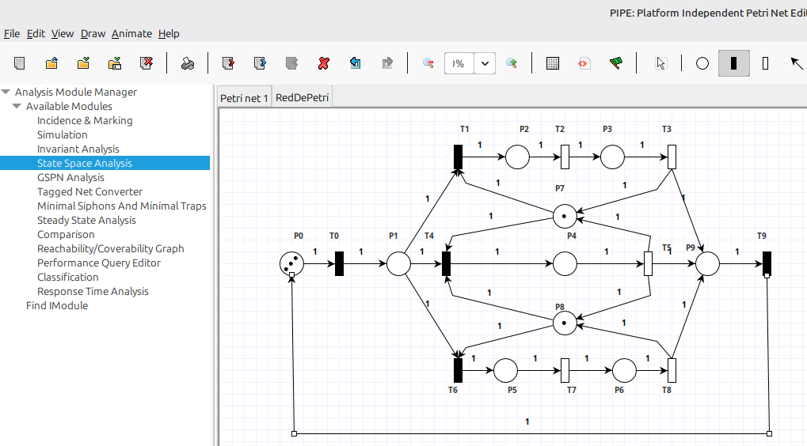
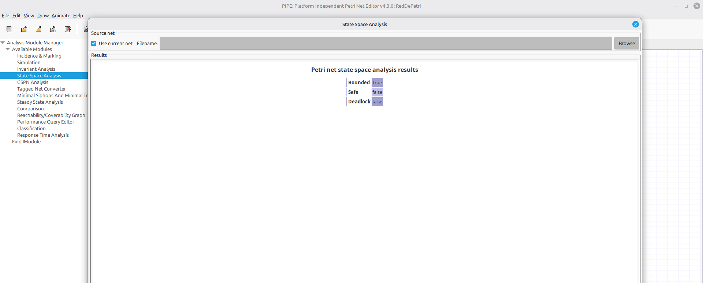
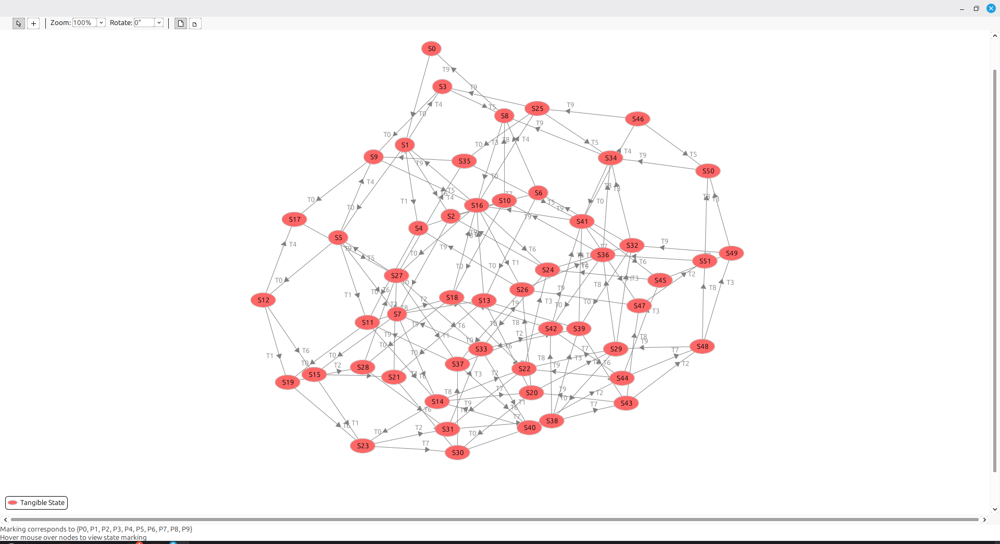
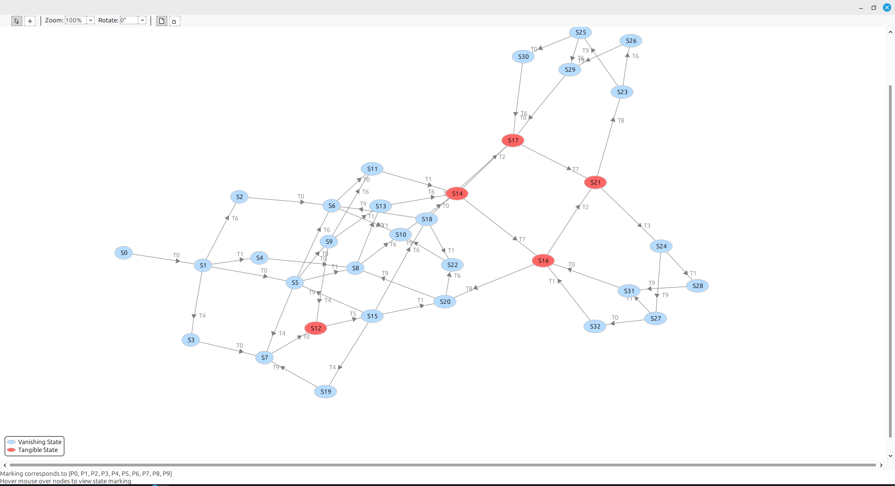
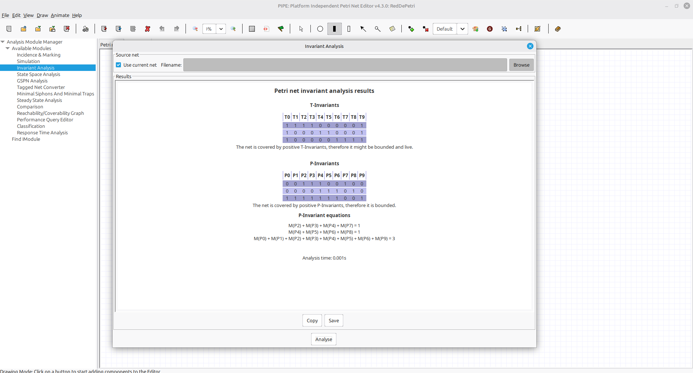
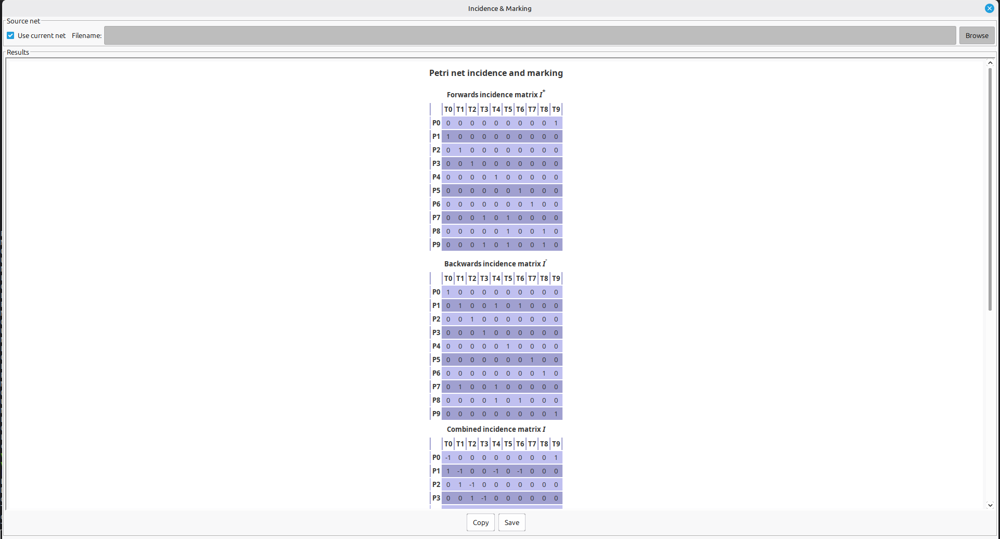
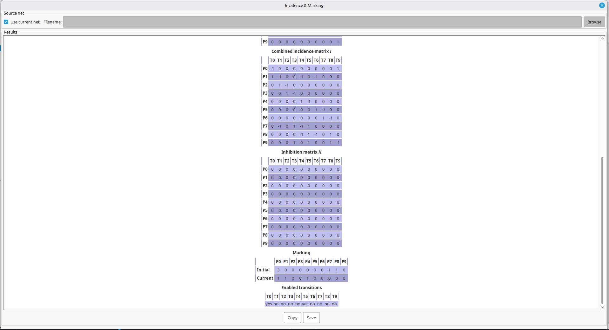
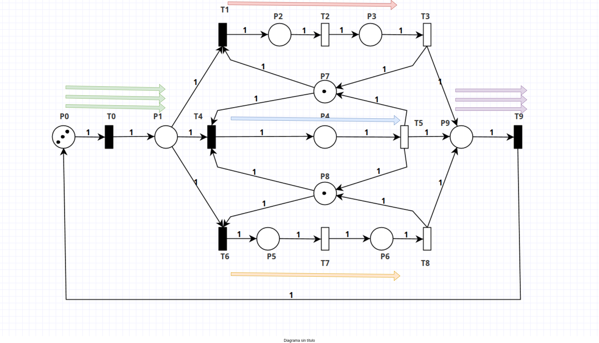

# Análisis de la red de Petri

El análisis se realizó con PIPE v4.3.0 sobre la red de Petri del sistema de procesamiento de transacciones de pago. Las transiciones T2, T3, T5, T7 y T8 se configuraron como temporales. Sus tiempos no se asignan en PIPE, ya que los resultados de este análisis no dependen de los valores de tiempo. Los invariantes tampoco dependen del tipo de cada transición, aunque ese tipo sí modifica el grafo de alcanzabilidad, como se muestra en la sección 2.2.

## 1. Red y marcado inicial

El marcado inicial tiene 3 tokens en P0, que representan las transacciones de la cola de arribo, y 1 token en cada recurso compartido: P7 (sesión con el Gateway de Red de Tarjetas) y P8 (slot del motor antifraude). Las demás plazas comienzan vacías.

En este marcado, T0 es la única transición sensibilizada, ya que es la única con tokens en todas sus plazas de entrada.

> 
> **Figura 1.** Red completa con el marcado inicial, con T2, T3, T5, T7 y T8 dibujadas como temporales.

## 2. Propiedades de la red

El módulo *State Space Analysis* arrojó los siguientes resultados:

| Propiedad         | Resultado | Interpretación                                                                 |
|-------------------|-----------|--------------------------------------------------------------------------------|
| Bounded (acotada) | `true`    | La cantidad de tokens de cada plaza tiene un límite.                           |
| Safe (segura)     | `false`   | Al menos una plaza puede contener más de un token.                             |
| Deadlock          | `false`   | No existe un marcado alcanzable en el que ninguna transición pueda dispararse. |

> 
> **Figura 2.** Resultados de *State Space Analysis*.

La red no es segura porque P0 ya contiene 3 tokens en el marcado inicial. Además, a partir de los invariantes de plaza de la sección 3 se deduce que es **3-acotada**: ninguna plaza puede superar los 3 tokens, y P0 alcanza ese valor.

### 2.1. Vivacidad

La ausencia de deadlock no alcanza para afirmar que la red es viva: indica que alguna transición siempre puede dispararse, mientras que la vivacidad exige que cada transición pueda volver a dispararse desde cualquier marcado alcanzable. Como *State Space Analysis* no informa esta propiedad, se utilizó el grafo de alcanzabilidad.

Para analizar la red sin restricciones de tiempo ni prioridades, se generó el grafo sobre una copia con las 10 transiciones marcadas como temporales, de modo que ninguna tuviera prioridad sobre otra. El grafo obtenido tiene 52 estados, de S0 a S51.

> 
> **Figura 3.** Grafo de alcanzabilidad de la copia con todas las transiciones temporales.

La vivacidad se justifica de la siguiente manera:

1. Desde cualquier marcado alcanzable, las transacciones en proceso (P2 a P6) pueden finalizar, ya que sus transiciones de salida solo requieren un token en su propia plaza. Al finalizar, liberan los recursos que retenían.
2. Con los recursos libres, las transacciones de P1 pueden completar un flujo de a una, y las de P9 pasan a P0 mediante T9. Por lo tanto, el marcado inicial se puede alcanzar desde cualquier marcado alcanzable, es decir, la red es **reversible**.
3. Desde el marcado inicial se puede completar cualquiera de los tres invariantes de transición, que en conjunto incluyen las 10 transiciones.

En consecuencia, desde cualquier marcado alcanzable se puede volver a disparar cualquier transición, y la red es **viva** cuando no se consideran tiempos ni prioridades.

### 2.2. Efecto de la prioridad de las transiciones inmediatas

Al generar el grafo de la red original, con T2, T3, T5, T7 y T8 como temporales, se obtienen 33 estados: 5 tangibles y 28 evanescentes. En un estado evanescente hay al menos una transición inmediata sensibilizada y, bajo la semántica GSPN de PIPE, solo pueden dispararse transiciones inmediatas mientras exista alguna.

> 
> **Figura 4.** Grafo de alcanzabilidad de la red original.

T4 solo sale de los estados S1, S5, S9 y S15 (numeración generada por PIPE en la Figura 4), que pertenecen a la parte inicial del grafo. Cuando se dispara T1 o T6 y el sistema entra en el régimen en el que conviven los flujos de tarjeta y transferencia, ya no puede volver a esos estados.

Esto se explica por la condición de sensibilización de T4, que requiere P7 y P8 libres a la vez. En ese régimen hay una transacción usando cada recurso y una tercera esperando en P1. Cuando un recurso se libera, la transacción en espera lo toma mediante una transición inmediata antes de que pueda finalizar el otro flujo, de modo que los dos recursos nunca quedan libres simultáneamente.

Por lo tanto, bajo la semántica GSPN de PIPE, T4 y T5 **dejan de ser vivas**. No se trata de un deadlock, ya que el sistema sigue procesando transacciones, sino de **inanición** del flujo de alto riesgo. El monitor en Java no tiene por qué replicar esta prioridad, pero la política de resolución de conflictos deberá contemplar esta situación.

## 3. Invariantes de plaza

Un invariante de plaza es un vector de pesos **y** tal que **yᵀ·I = 0**. Por lo tanto, la suma ponderada de tokens **yᵀ·M** se mantiene constante ante cualquier disparo y es igual a **yᵀ·M₀**. En esta red, las plazas de cada invariante tienen peso 1. El módulo *Invariant Analysis* obtuvo los siguientes:

| P0 | P1 | P2 | P3 | P4 | P5 | P6 | P7 | P8 | P9 |
|:--:|:--:|:--:|:--:|:--:|:--:|:--:|:--:|:--:|:--:|
| 0  | 0  | 1  | 1  | 1  | 0  | 0  | 1  | 0  | 0  |
| 0  | 0  | 0  | 0  | 1  | 1  | 1  | 0  | 1  | 0  |
| 1  | 1  | 1  | 1  | 1  | 1  | 1  | 0  | 0  | 1  |

Las ecuaciones correspondientes son:

```text
M(P2) + M(P3) + M(P4) + M(P7) = 1
M(P4) + M(P5) + M(P6) + M(P8) = 1
M(P0) + M(P1) + M(P2) + M(P3) + M(P4) + M(P5) + M(P6) + M(P9) = 3
```

PIPE informa que la red está cubierta por invariantes de plaza positivos y que, por lo tanto, es acotada. Toda plaza pertenece a alguna suma constante, por lo que sus tokens no pueden crecer sin límite.

> 
> **Figura 5.** Resultados de *Invariant Analysis*, con los invariantes de transición, los de plaza y las ecuaciones.

### Interpretación en el sistema de pagos

| Invariante                                                          | Qué garantiza                                                                     | Consecuencia                                                                                           |
|---------------------------------------------------------------------|-----------------------------------------------------------------------------------|--------------------------------------------------------------------------------------------------------|
| `M(P2) + M(P3) + M(P4) + M(P7) = 1`                                 | La sesión del gateway está libre o la utiliza exactamente una transacción.        | Los flujos de tarjeta y de alto riesgo se excluyen mutuamente en el uso del gateway.                   |
| `M(P4) + M(P5) + M(P6) + M(P8) = 1`                                 | El slot del motor antifraude está libre o lo utiliza exactamente una transacción. | Los flujos de transferencia y de alto riesgo se excluyen mutuamente en el uso del motor antifraude.    |
| `M(P0) + M(P1) + M(P2) + M(P3) + M(P4) + M(P5) + M(P6) + M(P9) = 3` | La cantidad de transacciones modeladas se mantiene constante.                     | Las transacciones no se pierden ni se duplican, y cada una se encuentra en una sola etapa del sistema. |

Del análisis conjunto de estas ecuaciones se desprende lo siguiente:

- **El flujo de alto riesgo se ejecuta sin otros flujos en proceso.** P4 aparece en las dos ecuaciones de recursos. Si `M(P4) = 1`, entonces P2, P3, P5, P6, P7 y P8 deben estar vacías.
- **Los flujos de tarjeta y transferencia pueden ejecutarse simultáneamente.** Ninguna de las dos ecuaciones de recursos suma P2 o P3 junto con P5 o P6, y esa situación es alcanzable: desde el marcado inicial, la secuencia T0, T0, T1, T6 deja una transacción en P2 y otra en P5. Por lo tanto, puede haber hasta 2 transacciones en proceso a la vez, una en cada uno de estos flujos.
- **El flujo de alto riesgo adquiere ambos recursos en un solo disparo.** T4 consume P7 y P8 de manera atómica, por lo que este flujo nunca retiene un recurso mientras espera el otro.

## 4. Invariantes de transición

Un invariante de transición es un vector **x**, con la cantidad de disparos de cada transición, tal que **I·x = 0**. Si existe una secuencia disparable con esas cantidades, al ejecutarla la red vuelve al marcado desde el que partió. El módulo *Invariant Analysis* obtuvo los siguientes:

| T0 | T1 | T2 | T3 | T4 | T5 | T6 | T7 | T8 | T9 |
|:--:|:--:|:--:|:--:|:--:|:--:|:--:|:--:|:--:|:--:|
| 1  | 1  | 1  | 1  | 0  | 0  | 0  | 0  | 0  | 1  |
| 1  | 0  | 0  | 0  | 1  | 1  | 0  | 0  | 0  | 1  |
| 1  | 0  | 0  | 0  | 0  | 0  | 1  | 1  | 1  | 1  |

PIPE informa que la red está cubierta por invariantes de transición positivos y que, por lo tanto, podría ser acotada y viva. Esta cobertura indica que toda transición participa de algún ciclo, pero por sí sola no demuestra la vivacidad.

### Interpretación en el sistema de pagos

| Invariante       | Flujo         | Recorrido de la transacción |
|------------------|---------------|-----------------------------|
| `T0 T1 T2 T3 T9` | Tarjeta       | Se admite, toma la sesión del gateway, solicita la autorización, realiza la captura, libera el gateway y pasa al buffer de salida. Finalmente, T9 la confirma y la envía a liquidación. |
| `T0 T4 T5 T9`    | Alto riesgo   | Se admite, toma el gateway y el motor antifraude, realiza el scoring, libera ambos recursos y pasa al buffer de salida. Finalmente, T9 la confirma y la envía a liquidación. |
| `T0 T6 T7 T8 T9` | Transferencia | Se admite, toma el motor antifraude, valida la cuenta destino, ejecuta la transferencia, libera el motor y pasa al buffer de salida. Finalmente, T9 la confirma y la envía a liquidación. |

Completar un invariante de transición significa que una transacción finalizó su procesamiento, que los recursos utilizados quedaron libres y que su token volvió a P0.

T0 y T9 forman parte de los tres invariantes porque todas las transacciones ingresan y salen por el mismo camino. La elección del flujo ocurre en el conflicto de P1, entre T1, T4 y T6.

## 5. Tabla de estados

La asignación de etapas a P2, P3, P5 y P6 sigue el orden de cada flujo descripto en el enunciado. Los invariantes de plaza de la sección 3 establecen las cotas de la columna **Máximo**, y todos esos valores se alcanzan.

| Plaza | Tipo    | Significado                                                          | Marcado inicial | Máximo |
|-------|---------|----------------------------------------------------------------------|:---------------:|:------:|
| P0    | Cola    | Transacciones en la cola de arribo (plaza IDLE)                      |        3        |   3    |
| P1    | Estado  | Transacción admitida, lista para ser ruteada a uno de los flujos     |        0        |   3    |
| P2    | Estado  | Tarjeta: autorización solicitada al issuer, a la espera de respuesta |        0        |   1    |
| P3    | Estado  | Tarjeta: captura de fondos en curso                                  |        0        |   1    |
| P4    | Estado  | Alto riesgo: scoring en curso, con consultas al gateway              |        0        |   1    |
| P5    | Estado  | Transferencia: validación de la cuenta destino                       |        0        |   1    |
| P6    | Estado  | Transferencia: ejecución en la red bancaria                          |        0        |   1    |
| P7    | Recurso | Sesión con el Gateway de Red de Tarjetas disponible                  |        1        |   1    |
| P8    | Recurso | Slot del motor antifraude disponible                                 |        1        |   1    |
| P9    | Buffer  | Transacciones procesadas, listas para confirmar y liquidar           |        0        |   3    |

## 6. Tabla de eventos

Todos los arcos de la red tienen peso 1, por lo que cada plaza listada consume o produce un token.

| Transición | Tipo      | Qué representa el disparo                                                      | Consume    | Produce    |
|------------|-----------|--------------------------------------------------------------------------------|------------|------------|
| T0         | Inmediata | Admite la transacción: parsing, validación de schema y autenticación superados | P0         | P1         |
| T1         | Inmediata | Rutea a tarjeta, toma el gateway y solicita la autorización                    | P1, P7     | P2         |
| T2         | Temporal  | Llega la respuesta del issuer y comienza la captura                            | P2         | P3         |
| T3         | Temporal  | Finaliza la captura y libera el gateway                                        | P3         | P7, P9     |
| T4         | Inmediata | Rutea a alto riesgo, toma ambos recursos y comienza el scoring                 | P1, P7, P8 | P4         |
| T5         | Temporal  | Finaliza el scoring y libera ambos recursos                                    | P4         | P7, P8, P9 |
| T6         | Inmediata | Rutea a transferencia, toma el motor antifraude y comienza la validación       | P1, P8     | P5         |
| T7         | Temporal  | Finaliza la validación y comienza la ejecución                                 | P5         | P6         |
| T8         | Temporal  | Finaliza la transferencia y libera el motor antifraude                         | P6         | P8, P9     |
| T9         | Inmediata | Confirma al cliente y envía a liquidación; el token vuelve a la cola           | P9         | P0         |

## 7. Verificación con las matrices de incidencia

La tabla de eventos se verificó con el módulo *Incidence & Marking* de PIPE. Las columnas **Consume** y **Produce** coinciden, para las 10 transiciones, con la matriz de incidencia hacia atrás (I⁻) y hacia adelante (I⁺), respectivamente.

La matriz combinada se obtiene como **I = I⁺ − I⁻**. Por ejemplo, en la fila P1 la columna T0 vale +1, porque produce un token, mientras que T1, T4 y T6 valen −1, porque cada una consume uno.

> 
> **Figura 6.** Matrices I⁺ e I⁻ de *Incidence & Marking*.

> 
> **Figura 7.** Resto de la matriz combinada y marcado de la red.

## 8. Cantidad de hilos y responsabilidades

> Se adoptan 9 hilos hasta confirmar con la cátedra la cantidad de hilos de T0. Ver la sección 8.2.

Los hilos son los encargados de ejecutar los disparos, y cada uno repite siempre su secuencia de transiciones. Un hilo no representa una transacción: procesa muchas a lo largo de la ejecución.

La red se dividió en segmentos a partir de los dos casos del enunciado. El conflicto se encuentra en P1 (T1, T4 y T6) y el join en P9, donde confluyen los tres flujos antes de T9.

### 8.1. Segmentos

| Segmento         | Transiciones | Criterio                          | Máximo de tokens simultáneos | Hilos |
|------------------|--------------|-----------------------------------|:----------------------------:|:-----:|
| A: admisión      | T0           | Anterior al conflicto en P1       |            P0 ≤ 3            |   3   |
| B: tarjeta       | T1, T2, T3   | Invariante posterior al conflicto |         P2 + P3 ≤ 1          |   1   |
| C: alto riesgo   | T4, T5       | Invariante posterior al conflicto |            P4 ≤ 1            |   1   |
| D: transferencia | T6, T7, T8   | Invariante posterior al conflicto |         P5 + P6 ≤ 1          |   1   |
| E: salida        | T9           | Posterior al join en P9           |            P9 ≤ 3            |   3   |
| **Total**        |              |                                   |                              | **9** |

- **Segmentos B, C y D (Caso 1):** se asigna un hilo por invariante. Un segundo hilo no tendría trabajo, ya que los invariantes de P7 y P8 permiten como máximo una transacción en cada flujo.
- **Segmento E (Caso 2):** después del join hay un solo camino y P9 puede contener hasta 3 tokens, valor que se alcanza en el grafo de 52 estados, por lo que se asignan 3 hilos a T9. T9 solo requiere un token en P9 para dispararse: el valor 3 es la acumulación máxima posible, no una condición de sincronización.
- **P1 no agrega hilos:** aunque puede contener hasta 3 tokens, sus transiciones de salida ya están asignadas a los segmentos B, C y D.

La cantidad de hilos no implica la misma cantidad de disparos simultáneos, ya que el monitor ejecuta los disparos de a uno. El paralelismo real se obtiene durante las esperas de las transiciones temporales, que se realizan fuera del lock.

### 8.2. Criterio para T0

El texto del Caso 1 indica un hilo para las transiciones anteriores al conflicto, lo que daría un total de 7 hilos. En cambio, en la Figura 2 del enunciado la transición anterior al conflicto tiene 2 hilos para 2 tokens.

Se adoptan provisoriamente 3 hilos en T0, siguiendo el criterio de la Figura 2 del enunciado y el objetivo de obtener el mayor paralelismo posible. Como T0 es inmediata, se espera que la ganancia sea reducida y se concentre al inicio de la ejecución. Ambas opciones respetan los invariantes de la red, por lo que la cantidad de hilos se definirá como configuración.

### 8.3. Gráfico de responsabilidades

> 
> **Figura 8.** Red con las responsabilidades de cada hilo, al estilo de la Figura 2 del enunciado: 3 flechas sobre T0, 1 a lo largo de T1-T3, 1 a lo largo de T4-T5, 1 a lo largo de T6-T8 y 3 sobre T9, con un color por segmento.

## 9. Relación con la implementación

- Los invariantes de plaza se verificarán después de cada disparo de la red.
- Los invariantes de transición se verificarán al finalizar la ejecución, mediante expresiones regulares aplicadas al log de transiciones disparadas.