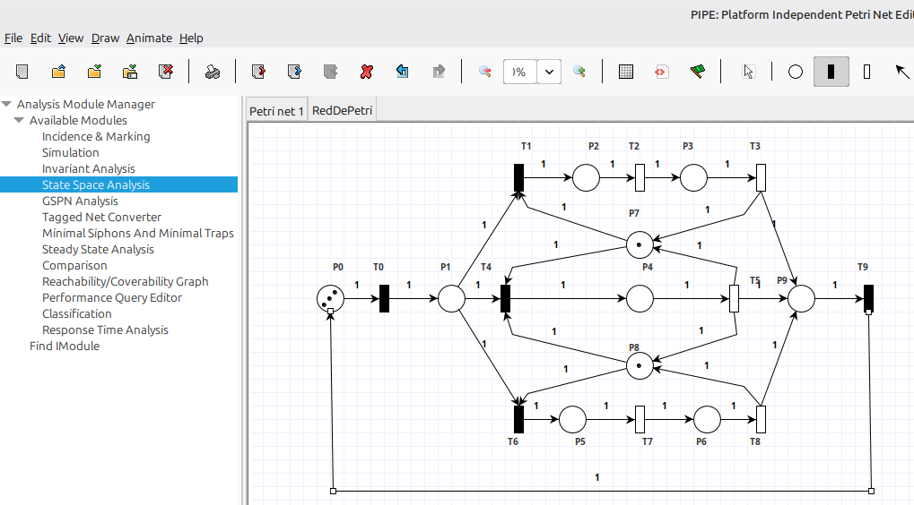
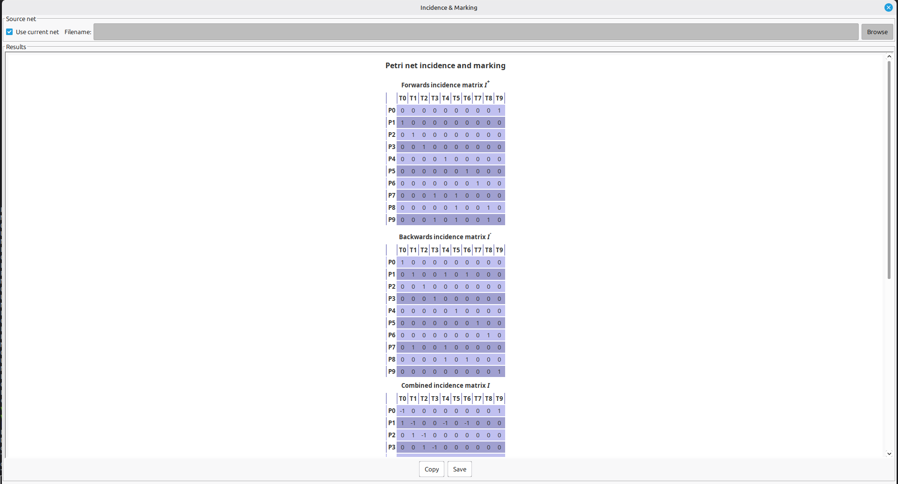
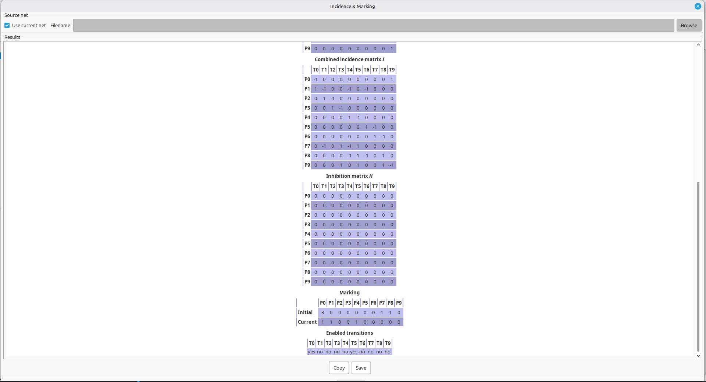
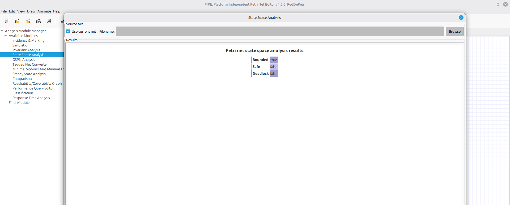
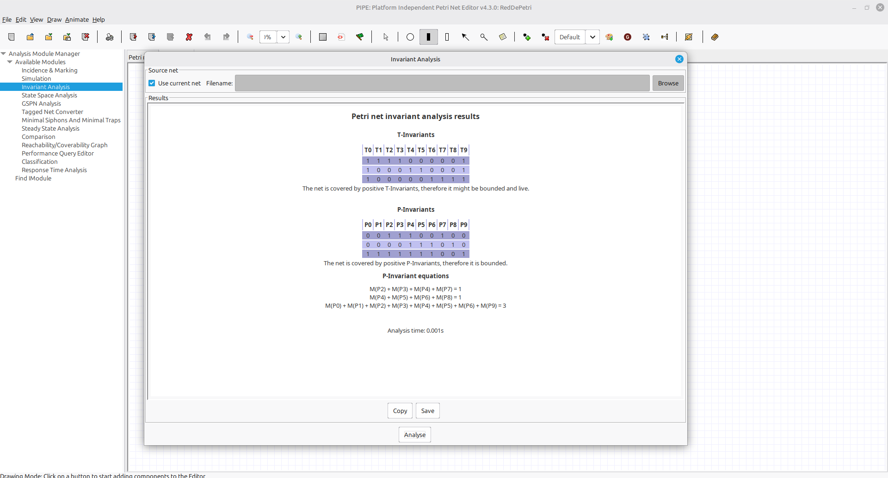
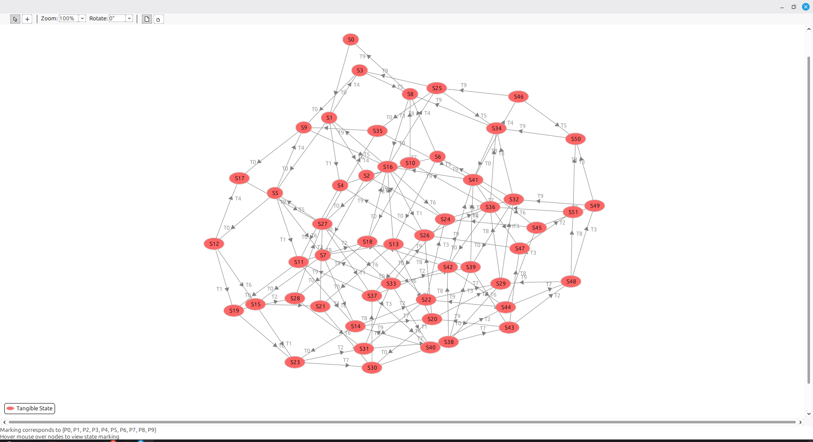
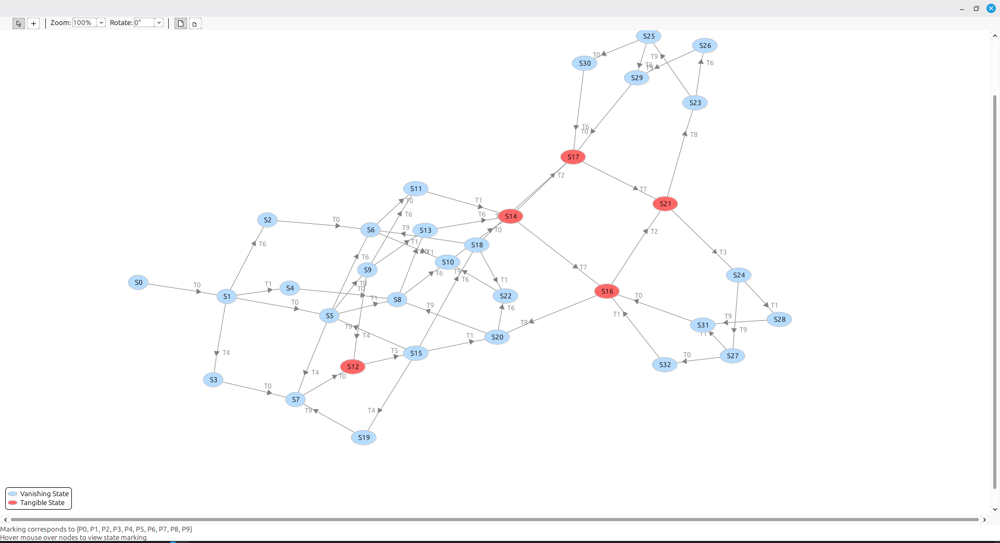
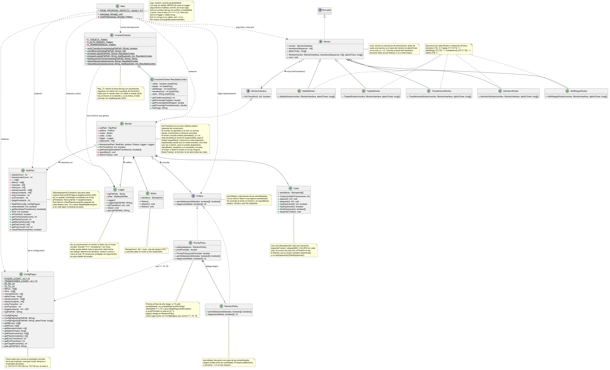
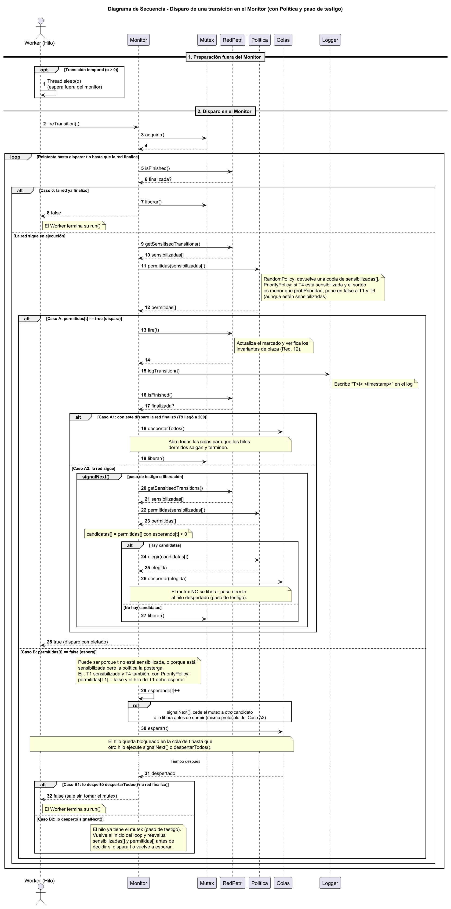
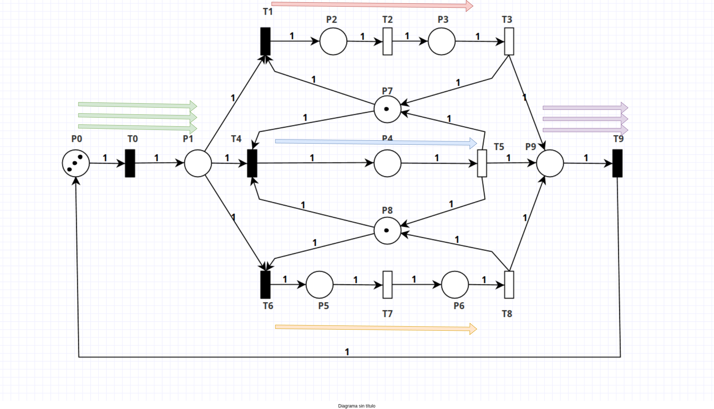

# Informe Trabajo Práctico Final
## Programación Concurrente y Paralela — 2026

**Sistema de procesamiento de transacciones de pago**

**Grupo:** Programación Con Currente

### Integrantes

- Chiavazza Labeguerié, Fiamma Itziar — 46851396
- Scagliotti, Marcos — 46070301
- Arias, Valentín — 45734482
- Tosolini, Franco Alberto — 45702152

**Repositorio:** https://github.com/francotosolini-cmyk/ProgramacionConCurrenteTP2

### 1. Objetivo

El trabajo consiste en implementar en Java una simulación concurrente de un sistema de procesamiento de pagos modelado mediante una red de Petri.

La implementación utiliza un monitor que coordina los hilos y protege el marcado de la red. Cada disparo debe respetar la disponibilidad de tokens y conservar los invariantes de plaza. El monitor recibe las solicitudes de los trabajadores y consulta una política para resolver la competencia entre los flujos.

Se comparan una política aleatoria y una política que favorece el procesamiento de pagos de alto riesgo. Cada ejecución debe completar 200 ciclos de procesamiento, finalizar todos sus hilos y producir un registro que permita verificar los invariantes de transición mediante expresiones regulares.

El análisis incluye la distribución de pagos por flujo y la duración de las ejecuciones con distintas configuraciones temporales.

### 2. Descripción del sistema

La red representa un sistema que recibe transacciones, las admite y las procesa por uno de tres flujos.

| Flujo | Etapas | Recurso requerido |
|---|---|---|
| Tarjeta | Autorización y captura de fondos | Gateway de tarjetas |
| Alto riesgo | Evaluación de riesgo | Gateway y motor antifraude simultáneamente |
| Transferencia | Validación de cuenta y ejecución bancaria | Motor antifraude |

El gateway y el motor antifraude son recursos exclusivos. Cada uno puede estar ocupado por una sola transacción a la vez y se mantiene reservado durante todo el flujo que lo utiliza.

Tarjeta y transferencia pueden avanzar concurrentemente porque utilizan recursos distintos. Alto riesgo requiere adquirir ambos recursos en un único disparo y los libera al finalizar su procesamiento.

El marcado inicial contiene tres tokens en la cola de arribo y un token en cada plaza de recurso disponible. Los tokens de transacción circulan por el sistema y vuelven a la cola de arribo después de completar un pago. Por lo tanto, los 200 ciclos exigidos se alcanzan mediante la reutilización de esos tres tokens.

Los tres flujos confluyen en un buffer de salida. Desde allí, la transición de salida confirma la finalización del pago y devuelve su token a la cola de arribo.

### 3. Modelo mediante red de Petri

La red tiene diez plazas y diez transiciones. Todos sus arcos tienen peso uno. El marcado indica cuántas transacciones se encuentran en cada etapa y cuáles recursos están disponibles.

#### 3.1. Plazas y marcado inicial

| Plaza | Significado | Tokens iniciales | Cota |
|---|---|---:|---:|
| P0 | Cola de arribo | 3 | 3 |
| P1 | Transacciones admitidas pendientes de ruteo | 0 | 3 |
| P2 | Tarjeta en etapa de autorización | 0 | 1 |
| P3 | Tarjeta en etapa de captura | 0 | 1 |
| P4 | Pago de alto riesgo en procesamiento | 0 | 1 |
| P5 | Transferencia en validación de cuenta | 0 | 1 |
| P6 | Transferencia en ejecución bancaria | 0 | 1 |
| P7 | Gateway disponible | 1 | 1 |
| P8 | Motor antifraude disponible | 1 | 1 |
| P9 | Buffer de pagos procesados | 0 | 3 |

El marcado inicial, ordenado desde P0 hasta P9, es:

M0 = (3, 0, 0, 0, 0, 0, 0, 1, 1, 0)

Un token en P7 o P8 indica que el recurso correspondiente está libre. Al comenzar un flujo, su transición de entrada consume los tokens de los recursos requeridos. La transición final del flujo los devuelve.

*Figura 1. Red de Petri del sistema de pagos con su marcado inicial.*

#### 3.2. Transiciones y eventos

| Transición | Evento | Consume de | Produce en | Tipo |
|---|---|---|---|---|
| T0 | Admisión de una transacción | P0 | P1 | Inmediata |
| T1 | Inicio del pago con tarjeta y reserva del gateway | P1, P7 | P2 | Inmediata |
| T2 | Fin de autorización y comienzo de captura | P2 | P3 | Temporal |
| T3 | Fin de captura y liberación del gateway | P3 | P7, P9 | Temporal |
| T4 | Inicio de alto riesgo y reserva de ambos recursos | P1, P7, P8 | P4 | Inmediata |
| T5 | Fin de alto riesgo y liberación de ambos recursos | P4 | P7, P8, P9 | Temporal |
| T6 | Inicio de transferencia y reserva del antifraude | P1, P8 | P5 | Inmediata |
| T7 | Fin de validación y comienzo de ejecución bancaria | P5 | P6 | Temporal |
| T8 | Fin de transferencia y liberación del antifraude | P6 | P8, P9 | Temporal |
| T9 | Confirmación de salida y retorno a la cola de arribo | P9 | P0 | Inmediata |

T4 adquiere P7 y P8 en el mismo disparo. Esto evita que una operación de alto riesgo retenga uno de esos recursos mientras espera adquirir el otro.

#### 3.3. Representación matricial

La clase `ConfigPagos` define las matrices de consumo I− y producción I+. Cada fila corresponde a una plaza y cada columna a una transición.

La clase `RedPetri` calcula la matriz de incidencia combinada:

I = I+ − I−

Para disparar una transición t, primero comprueba sus requisitos mediante I−. Después actualiza el marcado sumando la columna t de I:

M' = M + I[:, t]

La comprobación y la actualización se realizan bajo la exclusión mutua del monitor. Después de cada disparo se verifican los invariantes de plaza.

*Figura 2. Matrices de producción y consumo obtenidas en PIPE.*

*Figura 3. Matriz de incidencia combinada y marcado de la red.*

### 4. Propiedades e invariantes de la red

#### 4.1. Clasificación estructural

La red es ordinaria porque todos sus arcos tienen peso uno. También es pura, ya que ninguna plaza es simultáneamente entrada y salida de una misma transición.

No es una máquina de estados, ya que en esta red, por ejemplo, T4 tiene tres entradas y T5 tiene tres salidas. Ni tampoco es un grafo de eventos, porque P1 tiene tres transiciones de salida y P9 tiene tres de entrada.

La red presenta conflictos estructurales. T1, T4 y T6 comparten P1. Además, T1 y T4 comparten el gateway P7, mientras que T4 y T6 comparten el antifraude P8. En el marcado con un token en P1 y ambos recursos libres, las tres transiciones están sensibilizadas individualmente, pero disparar una deshabilita a las otras.

No cumple libre elección extendida porque las transiciones que comparten una entrada tienen conjuntos de entradas diferentes:

- T1 requiere P1 y P7.
- T4 requiere P1, P7 y P8.
- T6 requiere P1 y P8.

Por ese motivo tampoco cumple libre elección. La red no es persistente, ya que existe un marcado alcanzable donde el disparo de una transición deshabilita otra que estaba sensibilizada.

Al incorporar condiciones temporales en T2, T3, T5, T7 y T8, el modelo se considera no autónomo.

#### 4.2. Acotación y seguridad

La red es 3-acotada. Ninguna plaza puede superar los tres tokens, como se deduce de los invariantes de plaza.

No es segura, ya que P0 contiene tres tokens desde el marcado inicial y las plazas P1 y P9 tambien pueden alcanzar tres tokens. Las restantes están acotadas a uno.

*Figura 4. PIPE informa que la red es acotada, no es segura y está libre de deadlock.*

#### 4.3. Invariantes de plaza

En esta red se identifican tres P-invariantes básicos:

1. Conservación del gateway:

   M(P2) + M(P3) + M(P4) + M(P7) = 1

2. Conservación del motor antifraude:

   M(P4) + M(P5) + M(P6) + M(P8) = 1

3. Conservación de las transacciones:

   M(P0) + M(P1) + M(P2) + M(P3) + M(P4) + M(P5) + M(P6) + M(P9) = 3

Los dos primeros garantizan que cada recurso esté libre o reservado por una única transacción. El tercero conserva los tres tokens que circulan por las etapas de procesamiento y las colas.

La implementación comprueba estas tres ecuaciones después de cada disparo. Si alguna falla, lanza una excepción para señalar la inconsistencia.

#### 4.4. Invariantes de transición

Los tres T-invariantes básicos son:

| Flujo | Secuencia de un ciclo aislado | Vector en orden T0–T9 |
|---|---|---|
| Tarjeta | T0, T1, T2, T3, T9 | (1,1,1,1,0,0,0,0,0,1) |
| Alto riesgo | T0, T4, T5, T9 | (1,0,0,0,1,1,0,0,0,1) |
| Transferencia | T0, T6, T7, T8, T9 | (1,0,0,0,0,0,1,1,1,1) |

Cada ciclo admite una transacción, completa su procesamiento, libera los recursos y devuelve un token a P0. En una ejecución concurrente, los disparos de distintos ciclos pueden aparecer intercalados.

Al finalizar, el verificador analiza el registro mediante expresiones regulares para identificar los ciclos completos y comprobar que su total sea 200.

*Figura 5. P-invariantes y T-invariantes obtenidos mediante Invariant Analysis.*

#### 4.5. Vivacidad, home state y reversibilidad

El análisis sin restricciones temporales ni prioridades produce un grafo de alcanzabilidad de 52 estados.

Desde cualquier marcado alcanzable pueden terminarse los flujos en proceso, liberando sus recursos. Luego pueden procesarse las transacciones restantes de P1 y devolverse las de P9 a P0 mediante T9. De esta forma se puede regresar al marcado inicial:

M0 = (3, 0, 0, 0, 0, 0, 0, 1, 1, 0)

Por lo tanto, M0 es un home state y la red es reversible respecto de ese marcado, bajo las condiciones de este análisis.

Desde M0 puede ejecutarse cualquiera de los tres ciclos básicos, que en conjunto incluyen todas las transiciones. Como se puede regresar a M0 desde cualquier marcado alcanzable, todas las transiciones pueden volver a dispararse mediante alguna continuación. Así se justifica la vivacidad de la red sin prioridades.

La red también está libre de deadlock bajo esas condiciones.

*Figura 6. Grafo de 52 estados utilizado para analizar la red sin prioridades.*

#### 4.6. Efecto de las prioridades y finalización del programa

Las propiedades anteriores corresponden a la red sin prioridades. Una política puede restringir las secuencias que efectivamente se ejecutan.

En PIPE, al dar prioridad a las transiciones inmediatas sobre las temporales, el grafo obtenido tiene 33 estados. Puede alcanzarse un régimen donde tarjeta y transferencia se alternan ocupando los recursos y alto riesgo deja de tener oportunidades. T4 y T5 pierden vivacidad bajo esa semántica, aunque el sistema puede seguir procesando pagos.

*Figura 7. Grafo de 33 estados bajo la semántica GSPN de PIPE.*

En Java se utiliza una prioridad probabilística para favorecer alto riesgo y permitir oportunidades a los otros flujos. Las corridas realizadas muestran participación de los tres flujos con probabilidad 0.8. Esa evidencia experimental no demuestra ausencia de inanición para toda ejecución posible.

La simulación incorpora además una condición de cierre. Después de 200 admisiones se impiden nuevos disparos de T0. Al completarse las 200 salidas mediante T9, el monitor despierta a los hilos para que terminen. Este cierre es una restricción de la aplicación sobre la red cíclica.

### 5. Organización del programa

La implementación se organiza en paquetes que distribuyen las responsabilidades de configuración, ejecución, sincronización, políticas y registro.

| Paquete | Clases principales | Responsabilidad |
|---|---|---|
| `app` | `Main` | Construir el sistema, iniciar los hilos, esperar su finalización y mostrar los resultados. |
| `red` | `ConfigPagos`, `RedPetri` | Definir la red, mantener el marcado, comprobar la sensibilización y aplicar los disparos. |
| `monitor` | `MonitorInterface`, `Monitor`, `Mutex`, `Colas` | Proteger el estado compartido y coordinar las solicitudes de disparo. |
| `politica` | `Politica`, `RandomPolicy`, `PriorityPolicy` | Determinar qué transiciones se permiten y seleccionar candidatos a despertar. |
| `hilos` | `Worker` y sus subclases | Ejecutar repetidamente las secuencias asignadas a cada trabajador. |
| `registro` | `Logger`, `InvariantChecker` | Registrar los disparos y analizar los ciclos completados. |

#### 5.1. Configuración de la red

`ConfigPagos` centraliza los datos del modelo de pagos:

- Matrices de consumo y producción.
- Marcado inicial.
- Tiempos de las transiciones.
- Invariantes de plaza y sus constantes.
- Transiciones de admisión y salida.
- Objetivo de 200 ciclos.
- Ruta del archivo de registro.

Dispone de constructores que permiten utilizar la configuración predeterminada o proporcionar otra ruta de registro y otros tiempos.

El monitor recibe estos datos a través de `RedPetri` y consulta la política correspondiente. De esta manera, la lógica de sincronización puede operar sin identificar directamente las plazas o transiciones del sistema de pagos.

#### 5.2. Estado y dinámica de la red

`RedPetri` conserva el marcado actual y los contadores de disparos. Sus operaciones principales son:

| Método | Función |
|---|---|
| `isSensitised(t)` | Comprueba los requisitos de entrada de una transición y el límite de admisiones. |
| `getSensitisedTransitions()` | Construye el vector de sensibilización. |
| `fire(t)` | Actualiza el marcado, incrementa el contador y verifica los invariantes de plaza. |
| `isFinished()` | Indica si se alcanzó el objetivo de salidas. |
| `getMarcadoActual()` | Devuelve una copia del marcado para consultar el estado. |
| `getFireCount(t)` | Devuelve la cantidad de disparos de una transición. |

`RedPetri` delega la coordinación concurrente en el monitor. Durante la simulación, los trabajadores solicitan sus disparos mediante `MonitorInterface`.

#### 5.3. Arranque y finalización

`Main` selecciona la política a partir de los argumentos, prepara la configuración y construye la red, el registro y el monitor.

Después crea los nueve hilos, los inicia y espera su finalización mediante `join()`. Una vez que todos terminaron, cierra el registro y solicita su análisis, exigiendo exactamente 200 ciclos completos.

La salida informa los conteos y porcentajes por flujo, la validez del registro y la duración de la simulación. Cada corrida utiliza un archivo cuyo nombre identifica la política, la probabilidad cuando corresponde, y la fecha y hora.

*Figura 8. Clases del sistema y sus relaciones.*

### 6. Monitor y sincronización

El monitor concentra las solicitudes de disparo de los trabajadores. Su estado compartido incluye la red, la política y la información de las colas de espera.

Implementa `MonitorInterface`, que expone la operación:

boolean fireTransition(int transition)

El método devuelve `true` cuando la transición solicitada se dispara. Devuelve `false` cuando la simulación terminó, indicando al trabajador que debe finalizar.

El monitor obtiene la cantidad de transiciones desde la red y consulta sus operaciones de sensibilización y disparo. Las decisiones específicas sobre la prioridad de alto riesgo pertenecen a `PriorityPolicy`.

#### 6.1. Exclusión mutua

La clase `Mutex` utiliza un semáforo binario para controlar el acceso al monitor. Un hilo debe adquirirlo antes de consultar y modificar el estado compartido.

Bajo esta protección se realizan las siguientes operaciones:

- Comprobar si la simulación terminó.
- Consultar la sensibilización y las restricciones de la política.
- Disparar una transición y verificar los invariantes de plaza.
- Registrar el disparo.
- Actualizar los contadores de espera y seleccionar al próximo candidato.

La comprobación y la actualización del marcado quedan dentro de la misma sección crítica. Esto evita que dos hilos decidan utilizar simultáneamente un recurso basándose en el mismo estado anterior.

#### 6.2. Espera por transición

`Colas` dispone de un semáforo inicializado en cero por cada transición. Estos semáforos permiten bloquear a los trabajadores que todavía no pueden avanzar.

El monitor mantiene un contador `esperando[t]` por transición. El trabajador se contabiliza antes de ceder el acceso al monitor. Así puede ser seleccionado para despertar incluso si todavía no alcanzó la llamada bloqueante al semáforo.

Si la señal llega antes de que el trabajador se bloquee, el permiso queda disponible en el semáforo y su siguiente adquisición puede continuar.

#### 6.3. Solicitud de un disparo

Cuando un trabajador llama a `fireTransition(t)`, el monitor sigue este procedimiento:

1. Adquiere el mutex.
2. Comprueba si se completó el objetivo de la simulación. Si terminó, libera el mutex y devuelve `false`.
3. Obtiene las transiciones sensibilizadas y consulta `politica.permitidas(...)`.
4. Si la transición solicitada está permitida, ejecuta el disparo y lo registra.
5. Si todavía no terminó la simulación, busca un candidato para continuar.
6. Si la transición solicitada debe esperar, incrementa `esperando[t]`, cede el acceso mediante `signalNext()` y espera en la cola de esa transición.
7. Cuando despierta, comprueba si la red terminó. Si continúa activa, vuelve a evaluar la solicitud dentro del bucle.

La comprobación se repite al despertar. Esto permite aplicar la decisión actual de la política antes de cada disparo.

#### 6.4. Selección y paso de testigo

`signalNext()` obtiene las transiciones sensibilizadas, aplica `permitidas(...)` y filtra el resultado por aquellas que tienen trabajadores esperando.

Si existen candidatos, llama a `politica.elegir(...)`, descuenta un trabajador del contador de espera y libera un permiso en su cola.

El hilo señalizador devuelve el control sin liberar el semáforo global del mutex. El trabajador despertado continúa con el acceso al monitor transferido mediante este protocolo. Mientras tanto, los nuevos hilos que intentan entrar siguen esperando en el mutex.

Este mecanismo se denomina paso de testigo. Si no existen candidatos, `signalNext()` libera el mutex y permite el ingreso de otro trabajador.

#### 6.5. Esperas temporales y paralelismo

Las esperas temporales se realizan en `Worker`, antes de solicitar el disparo correspondiente. Durante esas esperas, el trabajador está fuera del monitor.

Por ejemplo, después de T1 el flujo de tarjeta mantiene reservado el gateway mientras espera para completar T2 y T3. En ese intervalo, el trabajador de transferencia puede avanzar utilizando el antifraude.

Los disparos modifican el marcado bajo exclusión mutua, mientras que las esperas de flujos que utilizan recursos distintos pueden solaparse.

La implementación utiliza esperas mínimas por etapa. El trabajador espera el tiempo configurado antes de solicitar el disparo; si después debe esperar en el monitor, el tiempo efectivo de la etapa puede ser mayor.

#### 6.6. Cierre de los trabajadores

Cuando se alcanza la salida número 200, el monitor libera permisos en todas las colas para despertar a los trabajadores bloqueados y permitir que también avancen los que lleguen tarde a esperar.

Los trabajadores despertados por el cierre reciben `false` y terminan. En este caso salen sin liberar nuevamente el mutex, porque el despertar de cierre no les transfiere el testigo.

Los hilos que todavía esperan en la entrada del monitor adquieren el mutex, detectan la finalización, lo liberan y reciben `false`.

Finalmente, `Main` espera a todos mediante `join()` antes de cerrar y analizar el registro.

*Figura 9. Solicitud de disparo, consulta a la política y coordinación mediante paso de testigo.*

### 7. Trabajadores y distribución de hilos

`Worker` es una clase abstracta que implementa `Runnable`. Cada trabajador recibe el monitor, una secuencia de transiciones y el arreglo de tiempos.

En su método `run()`, recorre repetidamente la secuencia asignada. Antes de solicitar una transición temporal, espera el tiempo configurado fuera del monitor. Después llama a `fireTransition(t)`.

Si la llamada devuelve `true`, continúa con la siguiente transición. Si devuelve `false`, finaliza su ejecución. Si el trabajador es interrumpido durante una espera temporal, conserva la marca de interrupción y termina.

Un trabajador puede procesar muchas transacciones durante una corrida. Los tokens representan las transacciones y los recursos dentro del modelo, mientras que los hilos ejecutan los segmentos asignados.

#### 7.1. Asignación de responsabilidades

La implementación utiliza nueve hilos distribuidos de la siguiente manera:

| Clase | Secuencia repetida | Cantidad de hilos |
|---|---|---:|
| `AdmisionWorker` | T0 | 3 |
| `TarjetaWorker` | T1, T2, T3 | 1 |
| `AltoRiesgoWorker` | T4, T5 | 1 |
| `TransferenciaWorker` | T6, T7, T8 | 1 |
| `SalidaWorker` | T9 | 3 |
| **Total** | | **9** |

Los constructores de las subclases proporcionan la secuencia correspondiente a la clase base. La lógica de repetición, espera temporal y finalización se concentra en `Worker`.

*Figura 10. Segmentos de la red asignados a los trabajadores.*

#### 7.2. Justificación del reparto

El conflicto de ruteo se encuentra en P1, donde las transacciones pueden continuar por T1, T4 o T6. Se asigna un hilo a cada uno de los tres flujos posteriores a ese conflicto.

Los invariantes de recurso limitan a una la cantidad de transacciones simultáneas en cada flujo. Tarjeta y transferencia pueden ejecutarse concurrentemente porque utilizan recursos diferentes. Alto riesgo ocupa ambos recursos durante su procesamiento.

En P9 confluyen los tres caminos. Como esta plaza puede acumular hasta tres tokens, se asignan tres trabajadores a T9, siguiendo el criterio del enunciado para el tramo posterior a la confluencia.

Para T0 se adoptan tres trabajadores, tomando como referencia los tres tokens de P0 y el criterio ilustrado en la figura de ejemplo del enunciado. El texto del caso anterior al conflicto también admite la interpretación de asignar un solo hilo a T0, lo que daría siete hilos en total. El grupo adoptó la alternativa de nueve hilos. Como T0 es inmediata y su disparo se ejecuta dentro del monitor, el aporte de sus trabajadores se concentra en atender las admisiones disponibles.

#### 7.3. Alcance del paralelismo

La cantidad de hilos indica cuántos trabajadores participan en la ejecución. Los disparos se realizan de a uno bajo la protección del monitor.

El solapamiento se produce durante las esperas temporales fuera de la sección crítica. En particular, tarjeta y transferencia pueden mantener una transacción en proceso cada una. Cuando alto riesgo está en procesamiento, ambos recursos quedan reservados por ese flujo.

La finalización de cada trabajador depende del valor devuelto por el monitor. Esto permite que todos compartan el mismo criterio de cierre al completarse las 200 transacciones.

### 8. Políticas de selección

La interfaz `Politica` define dos operaciones:

| Método | Responsabilidad |
|---|---|
| `permitidas(sensibilizadas)` | Determinar cuáles de las transiciones sensibilizadas pueden dispararse según la política. |
| `elegir(candidatas)` | Seleccionar una transición entre las candidatas que tienen trabajadores esperando. |

El monitor consulta `permitidas(...)` antes de autorizar un disparo. Para seleccionar al próximo trabajador, vuelve a consultar la política y cruza el resultado con las transiciones que tienen hilos esperando.

Esta separación permite aplicar la prioridad incluso cuando una transición está sensibilizada y su trabajador todavía no llegó a la cola de espera.

#### 8.1. Política aleatoria

`RandomPolicy.permitidas(...)` devuelve una copia del vector recibido, conservando todas las transiciones sensibilizadas.

`elegir(...)` cuenta las candidatas, sortea una posición entre ellas y devuelve el índice de la transición correspondiente. Todas las candidatas de esa llamada tienen la misma probabilidad de ser seleccionadas. Si el conjunto está vacío, devuelve `-1`.

El reparto final por flujo depende de los conjuntos de candidatas que aparecen durante la ejecución, de los recursos disponibles, de los tiempos y del orden de llegada de los trabajadores.

#### 8.2. Política priorizada

`PriorityPolicy` recibe una probabilidad entre cero y uno. Cuando T4 está sensibilizada, realiza un sorteo. Si el resultado es menor que la probabilidad configurada, deshabilita T1 y T6 en el vector de transiciones permitidas.

Las restantes transiciones conservan sus valores. Así pueden continuar la admisión, las etapas de procesamiento y la salida de pagos.

El método `elegir(...)` reutiliza la selección aleatoria de `RandomPolicy` sobre las candidatas que recibe del monitor.

Con probabilidad 1 se aplica prioridad estricta. Con probabilidad 0 se conservan todas las opciones de entrada. Para las corridas comparativas se utilizó 0.8.

#### 8.3. Motivo de la prioridad probabilística

Con prioridad estricta, cuando existe una transacción en P1 y ambos recursos están libres, T4 desplaza a T1 y T6. T4 toma ambos recursos y T5 los devuelve juntos al terminar.

Desde el marcado inicial, esta regla permite repetir el flujo de alto riesgo sin dar oportunidades a tarjeta y transferencia. La simulación puede completar los 200 ciclos con esos dos flujos relegados.

La versión probabilística permite que, en algunas consultas, T1 y T6 permanezcan habilitadas aunque T4 también pueda dispararse. En las corridas realizadas con probabilidad 0.8, alto riesgo aumentó su participación y los tres flujos procesaron pagos.

La probabilidad se aplica en cada consulta a `permitidas(...)`. Como el monitor puede consultar varias veces entre disparos, su valor no determina directamente el porcentaje final de pagos de alto riesgo.

#### 8.4. Alcance de la prioridad

La política actúa cuando T4 está sensibilizada. Para ello debe existir un token en P1 y estar disponibles los dos recursos.

Si alguno de los recursos está ocupado, la política conserva las transiciones sensibilizadas. Por lo tanto, su comportamiento favorece alto riesgo cuando puede comenzar y permite que las operaciones en curso terminen y liberen recursos.

Los resultados experimentales permiten evaluar el reparto obtenido en las corridas realizadas. Una probabilidad intermedia permite oportunidades para los demás flujos, pero no garantiza un tiempo máximo de espera ni demuestra ausencia de inanición en toda ejecución posible.

### 9. Registro y verificación de la ejecución

#### 9.1. Registro de disparos

`Logger` abre un archivo mediante `BufferedWriter` y lo mantiene abierto durante la corrida. Después de cada disparo exitoso, el monitor llama a `logTransition(t)` para escribir la transición y su instante temporal.

Durante la ejecución normal, el registro se realiza dentro de la sección crítica del monitor. Esto conserva el orden de los disparos en el archivo.

Cada corrida genera un nombre que identifica la política, la probabilidad cuando corresponde, y la fecha y hora. Por ejemplo:

ejecucion_priority-0.8_2026-11-17_16-25-45-045.log

Una vez que terminaron los trabajadores, `Main` cierra el registro para volcar los datos pendientes y comenzar su análisis.

#### 9.2. Verificación de invariantes de plaza

Después de cada disparo, `RedPetri` evalúa los tres invariantes de plaza definidos en la sección 4.3.

Cada comprobación calcula la suma ponderada de tokens y la compara con su constante. Si alguna ecuación falla, se lanza una excepción.

Esta verificación controla la conservación de las transacciones y de los recursos durante toda la corrida.

#### 9.3. Verificación de invariantes de transición

`InvariantChecker` lee las transiciones del archivo y construye una secuencia para analizarla mediante expresiones regulares.

El análisis busca los tres ciclos básicos:

- Tarjeta: T0, T1, T2, T3, T9.
- Alto riesgo: T0, T4, T5, T9.
- Transferencia: T0, T6, T7, T8, T9.

Los patrones permiten reconocer estos ciclos cuando sus etapas aparecen intercaladas con disparos de otros flujos. Al identificar un ciclo, se eliminan sus transiciones y se preservan los disparos intermedios para continuar el análisis.

El procedimiento se repite hasta que ya no puede reducir la secuencia. La corrida se acepta cuando el registro se reduce completamente y se reconocen exactamente 200 ciclos.

`Main` utiliza `procesarLog(ruta, totalEsperado)` para obtener en una sola operación la validez, los conteos por flujo y las transiciones restantes.

#### 9.4. Pruebas y comprobaciones

Las pruebas unitarias del proyecto cubren la dinámica de la red, la conservación de recursos, las políticas y el procesamiento del registro.

Las pruebas de `RandomPolicy` verifican los casos de una candidata, ninguna candidata y varias candidatas, además de la copia del vector de transiciones permitidas.

Las pruebas de `PriorityPolicy` utilizan probabilidades extremas para obtener resultados deterministas. Con probabilidad 1 comprueban el bloqueo de T1 y T6 cuando T4 está sensibilizada. Con probabilidad 0 comprueban que se conservan las opciones habilitadas. También verifican que el vector original permanezca intacto.

Las pruebas del monitor ejercitan la exclusión mutua, la espera y reactivación de trabajadores, y la finalización del sistema.

Las corridas completas que se presentan a continuación complementan esas pruebas con ambas políticas, tiempos activados y verificación del registro.

### 10. Resultados y análisis temporal

#### 10.1. Configuraciones utilizadas

Se utilizaron dos configuraciones de tiempos para estudiar su efecto sobre la duración y la distribución de pagos.

| Transición | Configuración A | Configuración B |
|---|---:|---:|
| T2 | 50 ms | 100 ms |
| T3 | 50 ms | 100 ms |
| T5 | 120 ms | 120 ms |
| T7 | 50 ms | 100 ms |
| T8 | 50 ms | 100 ms |

Las demás transiciones tienen tiempo de espera configurado en cero.

La configuración A se utilizó como punto de partida. Como sus corridas con política aleatoria quedaron por debajo de los 20 segundos, se duplicaron las esperas de tarjeta y transferencia para obtener la configuración B. Esta última quedó como configuración predeterminada.

Cada combinación de configuración y política se ejecutó dos veces. Todas las corridas completaron 200 ciclos, validaron el registro y finalizaron los nueve hilos.

#### 10.2. Mediciones

| Configuración | Política | Tarjeta | Alto riesgo | Transferencia | Duración |
|---|---|---:|---:|---:|---:|
| A | `random` | 100 | 0 | 100 | 12,581 s |
| A | `priority 0.8` | 14 | 172 | 14 | 23,348 s |
| A | `random` | 67 | 66 | 67 | 16,698 s |
| A | `priority 0.8` | 20 | 160 | 20 | 22,622 s |
| B | `random` | 67 | 66 | 67 | 23,044 s |
| B | `priority 0.8` | 18 | 164 | 18 | 24,604 s |
| B | `random` | 83 | 33 | 84 | 22,581 s |
| B | `priority 0.8` | 17 | 166 | 17 | 24,594 s |

Los ocho registros utilizados en las mediciones se incluyen en `resultados/evidencias/`.
La correspondencia entre cada medición y su archivo está documentada en
`resultados/analisis/corridas-temporales.md`.

#### 10.3. Estimación analítica

Tarjeta ocupa el gateway durante las esperas de T2 y T3. Transferencia ocupa el antifraude durante las esperas de T7 y T8. Alto riesgo ocupa ambos recursos durante la espera de T5.

Sean:

- nC: cantidad de pagos con tarjeta.
- nR: cantidad de pagos de alto riesgo.
- nB: cantidad de transferencias.
- αt: tiempo configurado para la transición t.

Para cada corrida, las ocupaciones mínimas acumuladas son:

G = nC × (α2 + α3) + nR × α5

F = nB × (α7 + α8) + nR × α5

La duración de la corrida debe ser al menos:

Tmin = máximo(G, F)

Se toma el máximo porque tarjeta y transferencia pueden utilizar sus recursos en paralelo. Los pagos de alto riesgo requieren ambos recursos y se incluyen en las dos sumas.

Esta estimación utiliza el reparto observado en cada corrida. Permite comprobar la coherencia de la duración medida con los tiempos de ocupación requeridos por esos pagos.

Por ejemplo, en la primera corrida de B con `random`, cada recurso acumuló:

67 × 0,200 s + 66 × 0,120 s = 21,32 s

La duración medida fue de 23,044 s, aproximadamente 1,72 s por encima del mínimo.

#### 10.4. Comparación de tiempos medios

Se calculó el mínimo estimado de cada corrida y se promediaron los dos resultados de cada combinación.

| Configuración | Política | Mínimo estimado medio | Tiempo medido medio | Diferencia |
|---|---|---:|---:|---:|
| A | `random` | 12,31 s | 14,64 s | 2,33 s |
| A | `priority 0.8` | 21,62 s | 22,99 s | 1,37 s |
| B | `random` | 21,04 s | 22,81 s | 1,77 s |
| B | `priority 0.8` | 23,30 s | 24,60 s | 1,30 s |

La duración medida incluye las esperas configuradas, la coordinación de los hilos, el registro y los intervalos en que los recursos quedan libres. Además, la reanudación de un hilo después de una espera depende de la planificación del sistema operativo.

Al pasar de A a B se duplicaron las esperas de tarjeta y transferencia. El tiempo medio aumentó más con `random`, donde esos flujos procesaron una mayor cantidad de pagos.

Las cuatro corridas de B quedaron dentro del rango de 20 a 40 segundos.

#### 10.5. Efecto de las políticas

Al sumar las dos corridas de cada combinación se obtiene:

| Configuración | Política | Tarjeta | Alto riesgo | Transferencia |
|---|---|---:|---:|---:|
| A | `random` | 167 (41,75 %) | 66 (16,50 %) | 167 (41,75 %) |
| A | `priority 0.8` | 34 (8,50 %) | 332 (83,00 %) | 34 (8,50 %) |
| B | `random` | 150 (37,50 %) | 99 (24,75 %) | 151 (37,75 %) |
| B | `priority 0.8` | 35 (8,75 %) | 330 (82,50 %) | 35 (8,75 %) |

En ambas configuraciones, la política priorizada aumentó la participación de alto riesgo. Con la configuración B pasó del 24,75 % al 82,50 %.

Tarjeta y transferencia también procesaron pagos en todas las corridas con prioridad probabilística.

La primera corrida de A con `random` completó 200 ciclos sin utilizar alto riesgo. Las demás corridas aleatorias sí utilizaron ese flujo. Esto muestra la variabilidad del reparto y la importancia de repetir las ejecuciones.

Las mediciones se limitan a dos corridas por combinación. Permiten comparar los escenarios ensayados y comprobar el rango temporal en esas ejecuciones, mientras que una caracterización estadística más amplia requeriría más repeticiones.

### 11. Conclusiones y ejecución

#### 11.1. Conclusiones

La implementación reproduce la dinámica de la red de Petri mediante trabajadores coordinados por un monitor. La comprobación y el disparo bajo exclusión mutua permiten reservar los recursos de acuerdo con el marcado.

El paso de testigo coordina la continuidad de los trabajadores en espera. Las esperas temporales fuera del monitor permiten el solapamiento de tarjeta y transferencia cuando utilizan recursos distintos.

Los invariantes de plaza se verifican después de cada disparo. El registro permite comprobar los ciclos completos al finalizar, identificar su distribución por flujo y exigir el total de 200.

La prioridad probabilística aumentó la participación de alto riesgo en los experimentos y permitió actividad en los otros dos flujos. El reparto observado depende de la política, de los tiempos y de la planificación de los trabajadores.

La comparación entre configuraciones permitió ajustar las esperas. La configuración B completó las cuatro corridas medidas dentro del rango de 20 a 40 segundos, con registros válidos y todos los hilos terminados.

#### 11.2. Compilación y pruebas

El proyecto requiere JDK 21 o superior e incluye Maven Wrapper.

Desde PowerShell, en la raíz del repositorio:

    .\mvnw.cmd package

Desde Linux o macOS:

    ./mvnw package

El comando compila el proyecto, ejecuta las pruebas y genera `target/tpfinal.jar`.

Para ejecutar solamente las pruebas:

    .\mvnw.cmd test

En Linux o macOS:

    ./mvnw test

#### 11.3. Ejecución de las políticas

En Windows:

    java -jar .\target\tpfinal.jar random
    java -jar .\target\tpfinal.jar priority 0.8

En Linux o macOS:

    java -jar target/tpfinal.jar random
    java -jar target/tpfinal.jar priority 0.8

Sin argumentos se utiliza `random`. Al indicar `priority` sin una probabilidad, se utiliza 0.8.

Después de modificar el código o los tiempos es necesario volver a generar el JAR.

#### 11.4. Archivos de resultados

Cada corrida genera un registro en `resultados/logs/`. El nombre contiene la política, la probabilidad cuando corresponde, y la fecha y hora.

El resumen final informa si se alcanzó el objetivo de salidas, la validez del registro, los conteos y porcentajes por flujo y la duración de la ejecución.

Los registros utilizados para el análisis deben conservarse junto con los resultados de las mediciones.

### 12. Referencias

1. Cátedra de Programación Concurrente y Paralela. *Enunciado del Trabajo Práctico Final 2026*.

2. *Algoritmos para determinar cantidad y responsabilidad de hilos en sistemas embebidos modelados con Redes de Petri S³PR*. Referencia indicada en el enunciado.
   https://www.researchgate.net/publication/358104149_Algoritmos_para_determinar_cantidad_y_responsabilidad_de_hilos_en_sistemas_embebidos_modelados_con_Redes_de_Petri_S_3_PR1

3. Grupo Programación Con Currente. *Análisis de la red de Petri en PIPE*.
   Documento del proyecto: `docs/AnalisisPIPE.md`.

4. Grupo Programación Con Currente. *Corridas con tiempos activados y análisis temporal*.
   Documento del proyecto: `resultados/analisis/corridas-temporales.md`.
